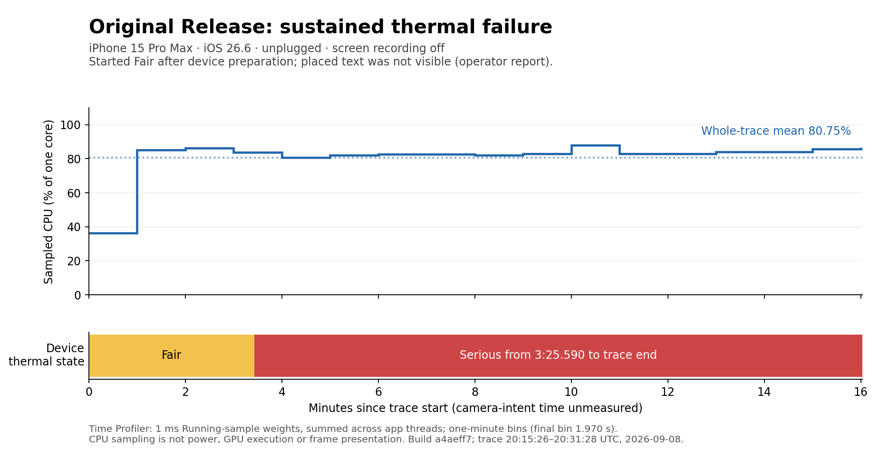
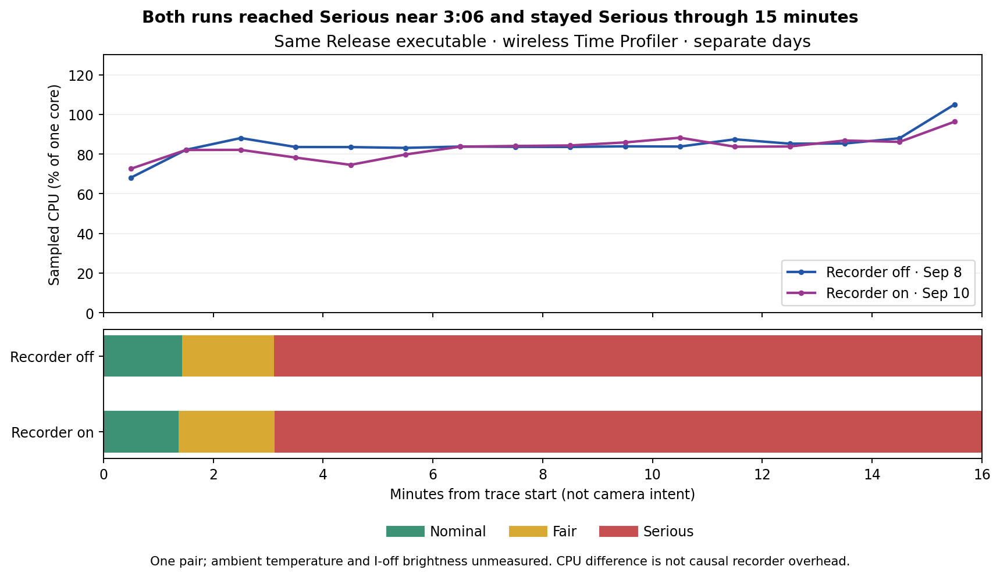

# Physical AR baseline — September 8–10, 2026

Issue [#3](https://github.com/CaptiveON/augmentmereality/issues/3), implementation
[PR #35](https://github.com/CaptiveON/augmentmereality/pull/35),
[measurement protocol](AR-BASELINE-PROTOCOL.md).

**Baseline acquisition and readiness qualification complete, with failures and
limits retained.** All three sustained traces record thermal failure.
The same implementation binary reached Serious after about 3 minutes 6 seconds
from trace start with the recorder both disabled and enabled, having begun
cool/Nominal. The unchanged build began Fair and had an operator-reported
content-visibility failure. The on/off runs occurred on different days, so their
difference is not a controlled estimate of recorder overhead. Separate physical
quality recordings cover cold, cached, delayed, missing, background/resume and
actual recovery behavior. Recovery lost the Room Test text; the recorder correctly
left hero readiness missing. No heat or visual improvement is claimed.

## Exact builds and retained evidence

| Class | Source SHA | Executable SHA-256 |
| --- | --- | --- |
| U, unchanged preimplementation checkout | `a4aeff7f9d1b6fd4e3cf9a57bd88eecda192df35` | `095dcf54650da57be5feeb4f9c68f5cd60e2a7c4e57dd2876e4201b4540709a8` |
| I-off / I-on, same instrumented binary | `d5d7a7f3c5693e6b17b7d04774c8db353a4ffa41` | `ae7da1a2471b4ef0c4f0e4910282d034bf9b6ea4d4ce2cca1a329492a2c78d3a` |

Both are signed Release builds from clean app-source trees. U is the checkout
immediately before implementation, distinct from issue #3's historical source
reference `9612f8211547d358f2511be5ccd632f0580dce02`. I embeds verified source
commit/hash, clean status and Release configuration. U has no embedded issue #3
metadata; its preserved build/installation manifests identify the executable.
The experiment flags are absent for default-workload comparisons.
Both archived apps identify version **0.9.0 (1)**, Xcode **26.6 / 17F113**, SDK
**iphoneos26.5 / 23F81a**, and deployment target 17.0. Device validation here is
on iOS 26.6; this is not minimum-OS validation. `artifact-info.json` preserves
these values read directly from the archived apps' Info.plists.

The durable local artifact root is
`/Users/captiveon/Documents/AR-Baselines/issue-3-2026-09-08/`.
`builds/U/` and `builds/I/` retain each app, dSYM and source/asset/build manifest.
These app bundles contain the existing service configuration and remain local.
Measurement artifacts are retained under `runs/`, with the original acquisition
paths under `/tmp/augmentme-issue3-evidence/` also recorded in generated summaries.
The [checked-in evidence](ar-baseline-evidence/2026-09-08/) includes all three build
manifests, thermal intervals, CPU summaries/extraction script, recorder exports,
generated reports and operator conditions. `builds/Q/` retains the later quality
build described below. `quality-artifact-integrity.json` identifies the retained
quality traces/videos and recorder exports by SHA-256; the full local archive
also preserves failed/incomplete attempts. Videos are local, not repository assets.

## U-steady: observed failure, not a cool-start acceptance run

Device: iPhone 15 Pro Max (iPhone16,2), iOS 26.6 (23G71). Time Profiler attached
wirelessly to an already launched Release process, PID 9552. Trace start was
**20:15:26.112 UTC**, end **20:31:28.082 UTC**, duration **961.970 seconds**.
Instruments 16.0 (17F113), deferred Time Profiler, 1 ms CPU sampling, no waiting
thread sampling; the template also records device thermal state. This was an
external profiling run, not an unprofiled thermal measurement or a cold launch.

The operator confirmed the phone stayed **unplugged** and **screen recording was
off throughout**. Xcode had copied device symbols before the run. Cool/nominal
state was not reverified afterward: the first recorded state was already Fair.
Ambient temperature, case, brightness, battery percentage, Low Power Mode and
auto-brightness were not measured for U. They must not be inferred from later runs.

The requested scene was Playground camera, initially empty, followed by one
Playground → 3D text placement (`ROOM TEST`, default style/scale, no USDZ asset).
The source-defined fixture uses system heavy font size 0.6, extrusion depth 0.12,
center alignment, scale 1 and color `#32ADE6`. Actual placement uses a center
raycast or the existing 2.5 m fallback; which path ran in U is unmeasured.
The operator confirmed placement but reported **the text was not visible**.
Actual camera-intent/placement timestamps and placement distance were not captured
by U. The trace's first ten seconds therefore cannot be labeled camera startup.
The operator's original heat report concerned every object and camera opening,
not one identified heavy asset. Castle remains a separately named test variant.

| Relative to trace start | Instruments device thermal state | Operator observation |
| --- | --- | --- |
| 0–205.590 s | Fair | Initially cool: unverified |
| Around the first response, logged at 20:18:41 UTC | Fair at that logged timestamp | Warm; exact observation time uncertain |
| 205.590–961.970 s | Serious | No continuous manual warmth scale |
| 10 min | Serious | Unmeasured at the exact milestone |
| 15 min | Serious | Unmeasured at the exact milestone |
| After recording ended | Not measured by the ended trace | Very hot; text had not appeared |

The Instruments state track is OS device-state evidence, distinct from both
operator-perceived warmth and an app `ProcessInfo` export (unavailable in U).
Serious began at **20:18:51.702 UTC**, 3 minutes 25.590 seconds into the trace.
No Critical interval appears in this trace. The existing ten-minute thermal
target fails for this observed run, subject to its initially Fair condition.

## U CPU samples and limits

The Time Profiler export contains **776,760 Running samples**, each weighted
1 ms, from +0.520 s to +961.969 s. Total sampled CPU weight is **776.760 s** over
961.970 s of elapsed trace time: **80.747% of one CPU core**, summed across app
threads. Main-thread weight is 78.722 s (8.183% of one core over the trace).
This is a sampling estimate, not scheduler-accounted utilization or energy.

The largest named leaf was RealityKit/CoreRE PhysX integer sorting (90.229 s
sample weight); other prominent leaves include PhysX spatial sorting and edge
construction. Stacks included CoreRE (267.439 s), RealityFusion (159.873 s),
Recon3D (135.788 s) and AppleCV3D (127.070 s). These are **inclusive, overlapping**
binary totals and must not be added. Some frames remain addresses/deduplicated
symbols. The evidence motivates reconstruction/physics isolation; it does not
establish that one subsystem caused the measured heat.

Actual presentation FPS/p95/p99, GPU execution, resident-memory peak, model
execution-device attribution, camera sample age and truthful hero readiness are
**unmeasured in U**: this template/unchanged build did not export those streams.
The 30 presented FPS and 40 ms presentation-p95 targets remain unmeasured.
No CPU sample count is used as a render-frame count.

| Evidence | Path beneath `runs/` |
| --- | --- |
| Original, unmodified trace | `U-steady.trace` |
| Capture command outcome and table definitions | `U-steady.log`, `U-toc.xml` |
| Complete thermal intervals | `U-device-thermal-state-intervals.xml` |
| CPU samples and derived windows, symbolicated with the archived U dSYM | `U-symbolicated-time-profile.xml`, `U-symbolicated-cpu-summary.json` |
| Reproducible CPU extraction and time-unit definition | `extract-time-profile.py` |
| Operator replies and uncertainty | `operator-observations.json` |
| Original build/installation provenance | `U-build-manifest.json`, `U-install.json`, `U-launch.json` |

The earlier `U-trace.log` attempt failed while Instruments was preparing the
device and supplies no measurement. System-log collection required unavailable
root privileges; its failure logs are not a substitute for a log archive.

## I-off: cool/Nominal start, visible text, sustained thermal failure

The same phone ran the archived I binary, recorder and experiment flags absent,
using the same wireless Time Profiler template. Instruments launched the process
(PID 9727); recording covered **20:39:08.889–20:55:10.318 UTC**, **961.429 s**.
The operator confirmed cool, app closed and unplugged before launch. The first
Instruments thermal interval independently reports **Nominal**.

The operator was asked to keep brightness/room setup unchanged, open Playground
camera, wait ten seconds, and place 3D text once. The text appeared and remained
visible in the near-ten-minute and end replies. Observed warmth progressed from
cool to hot, then very hot at those two later replies. Reply timestamps are
retained separately from requested checkpoint times; they are not exact event
timestamps. Camera intent, actual placement distance, brightness and battery
remain unmeasured in I-off because the recorder is disabled. The app process was
cold; OS/asset/shader caches were retained or unknown, not claimed uncached.

| Relative to I-off trace start | Instruments device thermal state |
| --- | --- |
| 0–86.123 s | Nominal |
| 86.123–186.120 s | Fair |
| 186.120–961.429 s | Serious |
| 10 min / 15 min | Serious / Serious |

The no-serious-state target at ten minutes **fails**, and Serious persists through
the extended observation. Actual presentation/capture FPS, frame p95/p99, GPU
execution and memory remain unmeasured by this external template. The thermal failure already occurs with the recorder disabled. The I-on
comparison and its limitations are described below.
U versus I-off is not a controlled improvement comparison because starting state,
process-launch method and observed content visibility differ.

I-off contains **815,999 Running CPU samples**, 815.999 s of sample weight over
961.429 s: **84.874% of one core**, summed across process threads. A sampled
`placeRoomDrop(content:assetName:)` stack appears at +41.214 s, followed by
920.215 s of trace coverage. That establishes sampled placement-path activity,
not the exact button/camera-intent time or a presented-hero timestamp. The operator
separately confirmed the text remained visible.

Artifacts: `runs/I-off.trace`, `I-off-toc.xml`,
`I-off-device-thermal-state-intervals.xml`, `I-off-symbolicated.trace`,
`I-off-symbolicated-time-profile.xml`, `I-off-trace.log`, `I-install.json` and
the shared `operator-observations.json`/`capture-commands.json`.

## I-on: recorder evidence through fifteen minutes

The archived I binary ran with `-ARBaselineMetrics` and no experiment flag on
**September 10**, using the same wireless Time Profiler template. Instruments
launched PID 20407 and recorded **22:27:09.473–22:43:10.946 UTC**, **961.473 s**.
The operator confirmed cool and unplugged before launch; Instruments and the app
both independently recorded Nominal initially. Camera-epoch conditions record
95% battery, unplugged battery state and brightness 0.95. Ambient temperature,
case, auto-brightness and the corresponding I-off values remain unmeasured.
The operator reported visible text and warmth after placement, then very hot with
text still visible in the near-ten-minute reply. The final reply confirmed very hot with text visible, unplugged and screen
recording off throughout. USB was connected afterward for separate quality checks.

| Relative to I-on trace start | Instruments device thermal state |
| --- | --- |
| 0–81.919 s | Nominal |
| 81.919–186.922 s | Fair |
| 186.922–961.473 s | Serious |
| 10 min / 15 min | Serious / Serious |

The recorder export at **22:43:23 UTC** covers **943.032 s after camera intent**,
including ProcessInfo health observations at camera +603.707 s and +901.816 s:
**Serious at both**. Its first Serious observation is camera +156.289 s.
Camera intent, process start and trace start are different origins; these values
must not be directly subtracted from one another without clock alignment.
The no-serious-at-ten-minutes target fails and Serious persists at fifteen minutes.

The selected hero ID is `3EAE26BB-6631-490D-A231-3C18B6C19169`, an existing
`text3D` geo drop about **406.115 m** away. It is **not the newly placed Room Test
text** reported visible by the operator. First fresh camera delivery was observed
at **378.489 ms** after camera intent and the selected asset was ready at
**569.226 ms**, but no `firstHeroSceneUpdateProxy` was recorded. This is not a
hero-presentation success. The separate readiness fixture now explicitly pins
the first Room Test selection, keeping the camera-intent origin unchanged.

The preceding `pre_camera` epoch lasted **29.531 s** and includes the ordinary
DragonAnim preload. This is a cold process with retained/unknown OS caches and
operator-delayed camera opening, not a claim of immediate or uncached startup.

| Camera-epoch stream | Count | Mean ms | Full p95 / p99 upper ms | First-10-s p95 / p99 ms |
| --- | ---: | ---: | ---: | ---: |
| Capture timestamp intervals | 28,276 | 33.337 | 34 / 34 | 33.337 / 33.337 |
| Capture delivery intervals | 28,276 | 33.337 | 34 / 36 | 50.226 / 82.030 |
| Scene-update intervals (proxy) | 32,828 | 28.721 | 35 / 35 | 33.555 / 54.453 |
| Capture sample age at delivery | 28,277 | 54.634 | 68 / 71 | 79.775 / 101.158 |
| GAR update elapsed duration | 2,604 | 1.262 | 3 / 4 | 0.831 / 1.203 |
| Person sentinel inference elapsed duration | 1,852 | 7.857 | 12 / 14 | 253.117 / 253.117 |
| Completed postprocess command-buffer GPU duration | 11,046 | 1.094 | 2 / 2 | 0.972 / 1.126 |

Full-epoch percentiles are conservative 1 ms histogram bounds; startup values
use exact nearest-rank samples. Scene-update cadence is **not presentation**.
The >=30 presented FPS and <=40 ms presentation-p95 gates remain **unmeasured**.
GPU samples cover the entire supplied completed command buffer while the pass
is attached; they do not isolate the semantic pass or measure GPU frame presentation.
Inference values are elapsed request time, not an execution-device attribution.
GAR update intervals have p95/p99 in the >1000 ms overflow bucket: their null
bounds are retained rather than reported as zero or a passing percentile.
Postprocess callback intervals include attachment gaps and do not describe
continuous rendering cadence.

Across retained camera-epoch system samples (+0.000 s to +943.032 s), cumulative
`getrusage` process CPU increased at **85.986% of one core**, summed across process
threads. Sampled resident memory ranged **294.984–496.234 MiB**, ending at
414.922 MiB. These are periodic resident-size observations, not physical footprint
or a continuous peak. Model CPU/GPU/Neural Engine attribution remains unmeasured.

GAR semantics was recorded active for **942.038 s**, reconstruction requested for
942.915 s, and the semantic postprocess active for **216.879 s**. The endpoint still
has GAR semantics enabled with the postprocess disabled. Person segmentation and
scene depth were requested for about 61.417 s each. Requested ARKit features are
not proof of actual per-feature execution. This workload evidence supports the
producer/consumer investigation in issue #4 without assigning a causal heat total
to any subsystem.

There were 126 retained system samples with no system-sample eviction. No epochs,
series, workload names or first-event names were dropped; 1,800 detailed events
were evicted from the bounded recent-event buffer. First milestones, whole-epoch
histograms and workload active durations remain retained. The compact raw JSON,
generated per-epoch report, thermal XML and original/symbolicated traces are
retained under `runs/I-on-*` and `runs/I-on.trace`. The checked-in
[I-on JSON](ar-baseline-evidence/2026-09-08/I-on-baseline.json) and
[generated report](ar-baseline-evidence/2026-09-08/I-on-recorder-report.md)
preserve the compact measurement evidence.

The external I-on Time Profiler export contains **800,359 Running samples**,
800.359 s of sample weight over 961.473 s, or **83.243% of one core**. I-off was
84.874%, a difference of **−1.631 percentage points** (−1.921% relative). This
negative observed difference does not imply that enabling the recorder reduces
CPU use: the conditions below are not controlled and there is no repeatability
estimate. External sampled CPU and recorder `getrusage` have different coverage
and measurement definitions, so they are reported separately.

I-off and I-on used the identical archived executable and the same external
profiling template. Their Serious transitions differ by **0.802 s from trace
start**, but the runs occurred two days apart and I-off lacks matching recorded
brightness, camera-intent timing and actual selected-content conditions. I-on
also included three wireless container-copy observations during acquisition.
These are limitations on causal overhead attribution; one pair cannot establish
repeatability or a negligible instrumentation cost. Metrics absent in I-off
(cadence, GPU and memory) remain unmeasured for the on/off difference.

## Separate USB quality checks

The quality build is **b45f43725166c156dfd69a8f871660d665f35923**, executable
SHA-256 **92209b05480f70430aa9bff4b38af25da3a24e4bd404bebf67b35654d4f0f7a6**,
archived under `builds/Q/`. It adds an explicit Room Test hero-selection fixture
and retains that selection across camera hides while clearing milestones for the
next epoch. Neither change was installed during the I-off/I-on comparison.
All quality runs use `-ARBaselineMetrics -ARBaselineExperiment` with
`AR_BASELINE_HERO_SOURCE=roomDrop`, USB connected, and a separate QuickTime movie
of the iPhone display. They are not thermal or uncontaminated performance runs.
Videos remain local because they show the operator's surroundings and device UI.

### Text, retained content, background return and actual recovery

`quality/Q-readiness-supported.trace` covers 22:50:55.087–22:55:56.231 UTC,
301.143 s. `quality/Q-readiness.mov` is 333.029 s at 1290×2796, with an approximately
59 FPS variable recording track. That is recording cadence, not app presentation.
The attempted RealityKit Frames instrument rejected iOS before launch; its failed
trace/log are retained. The successful repeat used Time Profiler, Core Animation
FPS and unrestricted os_signpost capture. Core Animation's export is explicitly
an FPS estimate and lacks per-hero presentation timestamps; it cannot establish
first-presented-hero or presentation p95/p99.

The exported `Q-signposts.xml` retains issue #3 signposts only late in this trace
(approximately +230.504 to +301.100 s). Startup milestones come from the recorder
JSON and video, not an assumed complete signpost history. The coverage summary
is retained alongside the XML. This is a capture-coverage limitation, not evidence
that startup work did not run.

The selected Room Test text ID is `1912CA4B-A2EC-46E9-9426-E8E8CBE90904`, at
1.968 m. This process spent 22.262 s before camera intent. Placement happened
4.625 s after intent, shorter than the requested ten-second empty-camera wait;
retain the actual interval rather than relabeling this as the prescribed wait.

| Actual scenario / generation | Fresh frame observed ms | Selected asset ready ms | Scene-update hero proxy ms | Visual outcome |
| --- | ---: | ---: | ---: | --- |
| Cold camera / 1 | 496.516 | 4,632.796 | 4,638.504 | Blue Room Test text appeared |
| Quick return after 0.855 s hidden / 2 | 75.332 | 24.659 | 75.387 | Same text retained |
| Return after 25.936 s hidden, session paused / 3 | 211.853 | 15.880 | 211.908 | Same text returned |
| Return after 29.164 s suspended / 4 | 387.541 | 4.817 | 387.658 | Text returned initially |
| Automatic recovery 11.608 s later / 5 | 88.247 | **missing** | **missing** | Text disappeared without another operator action |

Times in each row use that epoch's own origin. The longer hide/background durations
differ from the requested 15/10 seconds but do exercise the paused paths. The
recovery is an actual `resetTracking + removeExistingAnchors` configuration, with
a new generation and a fresh captured frame. It retains the intended hero ID but
correctly does not call the now-absent Room Test entity ready. Its exact trigger is
not recorded; the timing is consistent with the existing ten-second relocalization
timeout, an inference from source rather than a measured cause.

The operator first reported both returns survived, then clarified that the text
vanished after briefly returning from the Home Screen. The video confirms blue
text at about 246–257 s and its absence at 258 s. Earlier samples show Home at
64 s, camera by 65 s, no placed text at 68 s, and blue text by 69 s. At 136 s the
app Home is visible and at 137 s the retained text is visible again. These frame
samples correlate the visual sequence with the distinct epochs; cross-clock
alignment is approximately one second at this sampling resolution. No exact
GPU presentation latency is claimed. QuickTime's creation-date metadata predates
the recording button and must not be used as its start timestamp.

This establishes readiness-recorder behavior while documenting a real content-loss
failure for the existing lifecycle work in issue #18 and recovery UI work in #17.
The [raw JSON](ar-baseline-evidence/2026-09-08/Q-readiness-baseline.json) and
[per-epoch report](ar-baseline-evidence/2026-09-08/Q-readiness-report.md) retain
all cold/resume/recovery values separately.

### Delayed model and cached return

The original `toy_drummer` attempt is **incomplete**: the operator could not select
it because the scrolling Playground menu returned to its previous position. Its
trace and `quality/Q-delayed-drummer-selection-blocked.mov` are retained. The
fixture was repeated in a fresh process with the visible **DragonAnim** menu item,
not relabeled as a successful drummer test.

`Q-delayed-dragon` disables `assetPreload`, delays DragonAnim by three seconds and
pins Room Test ID `DDA8AB6E-08AD-4FE2-9800-9D6A6B4BF240`, initially 1.978 m away.
The recorder observes a placeholder at camera +4.285 s, starts the fixture delay
at +4.305 s, starts actual decode at +7.315 s and finishes decode at +15.890 s.
The measured decode is about **8.575 s**, separate from the artificial wait.
Selected-asset readiness is +15.925 s and the scene-update proxy follows it.
The operator independently reported the placeholder first and the dragon after
roughly nine seconds; that estimate is not substituted for recorded timings.
The video shows the loaded dragon. A later quick camera return retains the same
selected ID and records its warm-resume scene-update proxy at **66.643 ms**;
the operator confirmed the dragon returned. The separate 171.755-second video
shows a blue placeholder at 40–50 s and the actual dragon by 55 s. The
[raw JSON](ar-baseline-evidence/2026-09-08/Q-delayed-dragon-baseline.json)
and [report](ar-baseline-evidence/2026-09-08/Q-delayed-dragon-report.md) preserve
the exact measured order.

### Missing selected model

The successful `Q-missing-dragon-only` process uses the same Q executable with
asset preload disabled and `AR_BASELINE_MISSING_ASSET=DragonAnim`. It selects
DragonAnim first, pinning ID `4A00C3C0-29D2-4ED4-ABCE-C286C64E5479`, at 1.968 m.
Initial ProcessInfo state was Serious, battery 95%, charging, brightness 0.95;
this is a quality fixture, not another cool-start thermal measurement.

After 22.813 s before camera intent, the first fresh frame arrives at camera
+306.171 ms. Selection is at +11.977 s, placeholder placement at +11.980 s,
and the actual RealityKit request for the deliberately absent resource fails at
+12.004 s. The selected identity remains DragonAnim. Through the export at
**23:19:04 UTC**, camera +267.997 s, **selected-asset readiness and hero scene-update
proxy are both absent**. A visible failure marker therefore does not fabricate
successful readiness. The operator reported “its some text”; the preview shows
the blue `3D?` fallback defined in `DropEntityFactory`, with no dragon.

The separate continuous movie `quality/Q-missing-dragon-attempts.mov` is
762.676 s and includes incomplete attempts and relaunches. A separate 60-second
passthrough excerpt, `quality/Q-missing-dragon-excerpt.mov`, retains original
video seconds 440–500 for quick review; the original movie is preserved. Earlier attempts
opened the camera without selecting a model, then selected text before the
missing dragon; neither qualifies as a missing-selected-hero run. Their original
JSON/trace and operator observations remain in the archive. The successful final
process was launched by `devicectl` without an external profiler or time limit;
the earlier `Q-missing-dragon.trace` does not cover it. The movie shows the final
relaunch on Home at 440–450 s, camera at 456 s, and the Playground menu at
462–466 s. The blue failure marker and red “A 3D model couldn't be loaded” banner
are visible at 468 and 470 s. The banner is gone at 471 s; the fallback remains
at 700 s. These sampled visual times are not exact presentation
latencies. The [raw JSON](ar-baseline-evidence/2026-09-08/Q-missing-dragon-baseline.json),
[conditions](ar-baseline-evidence/2026-09-08/Q-missing-dragon-conditions.json) and
[report](ar-baseline-evidence/2026-09-08/Q-missing-dragon-report.md) retain this
successful qualification separately from those incomplete attempts.

After the final export, recording was stopped and the app was relaunched normally
without measurement/experiment arguments or environment. No fixture remains active.

## Implementation checks and qualification limits

39 focused simulator tests passed for bounded statistics, epochs, fresh frames,
placeholder handling, workload policy and video-format policy. After adding the
explicit missing-resource fixture, all four experiment tests passed, including
the new fixture/default-isolation regression (40 distinct selected tests in total).
Six Python report/build-provenance tests passed. Signed Release compilation and
embedded provenance verification passed. These results establish implementation
behavior, not physical presentation or thermal success.

[GitHub CI run 34275146718](https://github.com/CaptiveON/augmentmereality/actions/runs/34275146718)
also passed **179 local simulator tests**, including the native Firestore emulator
regression, plus the report/drift and Firestore rules jobs. Raw iOS CI output is
retained in `runs/CI-ios-tests.log`; CI retains the original test artifacts.

On the later documentation-only commit, the Swift 6.3.3 compiler crashed in
`SendNonSendable` analysis of the existing streetscape-mesh callback before tests
ran. The failed build log is retained in `runs/CI-0ba0403/build.log`. The
[retry of run 34278322491](https://github.com/CaptiveON/augmentmereality/actions/runs/34278322491)
passed all 179 tests without source changes; its output is in
`runs/CI-rerun-ios-tests.log`.

The Room Test target option and camera-hide selection regression passed all ten
focused experiment/readiness tests on September 10. The updated signed Release
quality build is archived separately from the unchanged on/off comparison binary.

[CI run 34538554041](https://github.com/CaptiveON/augmentmereality/actions/runs/34538554041)
passed **181 simulator tests**, plus rules and drift/report checks, on the Q source.
Its first attempt passed 180 tests and failed the native pending-delete Firestore
regression with client-offline error 14 after transport-readiness delays. A retry
passed all 181 without source changes. Both attempts and the original result
bundles are retained; this does not establish the cause of that transient failure.

Issue #3 supplies instrumentation and a repeatable protocol, plus the three
sustained acquisitions and single physical scenario qualifications above.
The ten-minute thermal target **fails**; the >=30 presented FPS and
<=40 ms presentation-p95 targets remain **unmeasured**. One recorder pair on
different days documents the observed CPU/thermal difference and its limitations;
it does not establish causal overhead or repeatability. Immediate-camera startup,
controlled five-repeat distributions, the full isolated-subsystem matrix, actual
GPU presentation and model execution-device attribution remain **unmeasured**.
The protocol defines those future runs; no results are inferred from its existence.

These limits do not block issue #3's measurement implementation: its acceptance
criteria explicitly allow failures and unmeasured fields and do not require a thermal
improvement. Producer/consumer demand is existing issue #4, hero/recovery UI is
#17, placement retention across recovery is #18, and final performance/quality
acceptance after that work is #32. This report is baseline evidence for those
tasks, not a release-performance sign-off.
